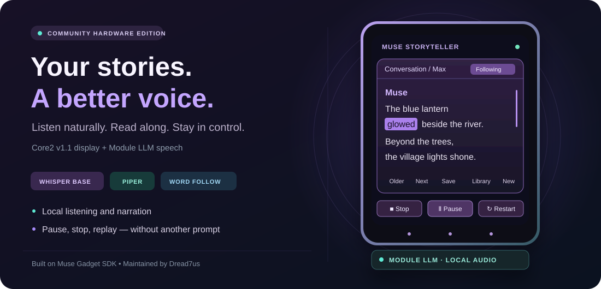
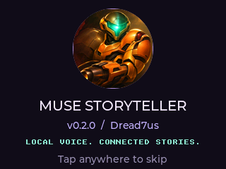
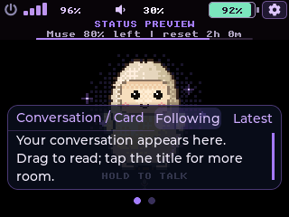
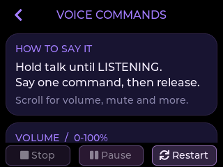
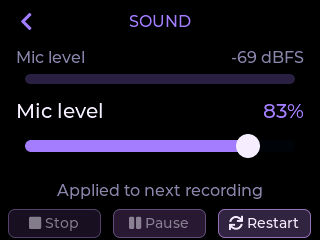

<div align="center">

# Muse Storyteller

**Edition v0.5.3**

### A small companion. A better voice. Stories worth listening to.

[](docs/HARDWARE.md)
[](https://docs.m5stack.com/en/module/Module_LLM)
[](#what-runs-where)
[](docs/INSTALL.md)
[](LICENSE)
[](https://github.com/Dread7us/Muse-Storyteller/actions/workflows/checks.yml)

**Whisper Base listening · Piper or native Muse narration · Word-following**



<sub>Interface illustration—not a photograph, benchmark, or captured device screen.</sub>

[Screenshots](#on-the-device) · [Features](#what-this-edition-adds) · [Hardware](#the-hardware-you-need) · [Get started](#getting-started) · [Voice commands](#voice-commands-that-actually-control-the-device) · [Validation](docs/VALIDATION.md)

**Built on [Meta’s Muse Gadget SDK](https://github.com/facebookincubator/muse-gadget-sdk),
[M5Stack StackFlow](https://github.com/m5stack/StackFlow), [Whisper](https://github.com/openai/whisper),
and [Piper](https://github.com/rhasspy/piper).**
This community edition adds the speech, reader, recorder, and control experience described below.

</div>

---

Native Muse narration is an optional online path using the existing Muse account allowance,
with Piper kept for offline narration. See [native voice setup and limits](docs/NATIVE-VOICE-DEVELOPMENT.md).

Prepared Helio/Aria narration now uses independently checked, sentence-aware sections.
The opening can play while later sections arrive; real word timings travel with each
section, and incorrect or repeating generated speech is retried before admission.
Pause, live volume, Stop and cached Restart stay available during narration and buffering.
This path requires the matching Muse-side helpers described in the setup notes.
Fresh online replies still depend on Muse's response and audio-generation time;
a prior successful fresh-response check took about 50 seconds to first speech.
See the [measured checks and remaining limit](docs/VALIDATION.md#editions-040041-verified-sentence-narration).
The startup splash and reply reader now show a full-to-empty **work remaining**
bar with the current step and an estimated countdown. Estimates are marked `*`,
learn locally from successful preparation, and never reach zero before real readiness.

Sound now also offers **Muse app voice – direct**: it retrieves the response's
native audio without asking Muse to create and deliver a separate file. It uses
the Muse app's selected voice and pace; Helio/Aria retain the device's speed presets.

## On the device

Real screen captures from **v0.2.0**. Click a screen to view it at full size.

<table>
  <tr>
    <td align="center" width="50%">
      <a href="docs/assets/screenshots/splash.png"></a><br>
      <strong>A welcome with personality</strong><br>
      <sub>A brief welcome screen shows the software version. Tap anywhere to skip it.</sub>
    </td>
    <td align="center" width="50%">
      <a href="docs/assets/screenshots/idle.png"></a><br>
      <strong>Ready for your first conversation</strong><br>
      <sub>The post-splash layout, before speaking. Header readings use Status Preview examples.</sub>
    </td>
  </tr>
  <tr>
    <td align="center" width="50%">
      <a href="docs/assets/screenshots/voice-commands.png"></a><br>
      <strong>Commands within reach</strong><br>
      <sub>Learn what to say without leaving the device.</sub>
    </td>
    <td align="center" width="50%">
      <a href="docs/assets/screenshots/sound.png"></a><br>
      <strong>See it. Adjust it.</strong><br>
      <sub>A live microphone meter and familiar sliders in Sound.</sub>
    </td>
  </tr>
</table>

The purple transport row uses equally sized **Stop · Pause/Resume · Restart** buttons.
Unavailable actions dim automatically; Pause changes to Resume during paused playback.

## What this edition adds

| | Addition | The difference you notice |
|---|---|---|
| 🎙️ | **English Whisper Base** | Local recognition for hold-to-talk and Recorder. The model stays loaded between recordings. |
| 🔊 | **Piper narration** | The tested U.S. English Lessac-low voice, with Slow / Normal / Fast pacing and sentence-aware buffering. |
| 📖 | **A reader that follows** | Word highlighting and automatic scrolling follow playback. Switch between Card, Max, and two-line views; turn Follow off to read freely. |
| ⏯️ | **Centered playback controls** | Stop, Pause/Resume, and Restart remain available in the conversation and Settings. Restart reuses received text rather than requesting a new answer. |
| ✨ | **Readable formatting** | Emphasis, lists, quotes, code, and links render in the conversation card. Speech skips formatting marks and applies context-sensitive pronunciation. |
| 🎚️ | **Settings that actually change** | Explicit spoken commands apply volume, mute, brightness, and speech speed, then confirm the stored value. Muting is visible in the header. |
| 🗂️ | **Local conversation library** | Automatic drafts, bookmarks, paging, resume, deletion, and regenerated titles. Bounded recent context and local recall support longer conversations. |
| 📝 | **Local Recorder** | Screen-off recording, text transcripts, optional compressed WAV chunks, and a separate conservative AI-reviewed copy. Original text is retained. |
| 🌤️ | **Useful status at a glance** | Battery, Wi-Fi strength, selected volume/mute, optional five-day weather, and a clearly labeled Muse allowance estimate. |

The additions were developed and exercised on a real Core2 v1.1 + Module LLM stack.
This repository is a **source preview**, not a universal factory-to-finished installer.
See the [installation boundary](docs/INSTALL.md) before changing a working device.

## The hardware you need

| Required | Purpose |
|---|---|
| **M5Stack Core2 v1.1** | Display, touch controls, settings, Wi-Fi, and the paired Muse connection. |
| **M5Stack Module LLM — AX630C / M140** | Its own microphone, speaker, storage, and local speech processing. |
| **Stable power for the stack and Module** | The reference setup uses external power for Module LLM. Do not assume the Core2 battery powers it. |
| **USB data access during setup** | Core2 for firmware; Module LLM’s own USB-C port for ADB maintenance. |
| **Wi-Fi + a paired Muse account** | Needed for Muse-generated replies, not for the local speech engines. |

**LLM Mate is not required. A microSD card is not required for the tested configuration.**
Core2 v1.0 has a different power-management profile and is **not validated by this release**.
[Hardware and power notes →](docs/HARDWARE.md)

## What runs where

```text
                    Wi-Fi / your paired Muse account
                                  │
Your voice → Module LLM → recognized text → Muse’s reply
             Whisper Base                         │
                                                  ▼
             Core2 reader  ← word timing ← Module LLM
             touch + controls                  Piper voice
```

**Local and offline:** speech recognition, speech synthesis, explicit settings commands,
recording, saved transcripts, and the local conversation archive. AI transcript review
also uses the Module’s local model when available.

**Online:** Muse’s answers, weather, and fresh account-usage checks. Muse’s account
allowance and service terms still apply. This project does not make Muse itself offline,
increase its allowance, or add a paid speech API.

**Usage is an estimate between syncs.** A fresh website check currently needs the optional
Windows Chrome helper, signed into Muse, with Module USB connected. The on-device
button says **Sync via PC**, distinguishes waiting from success/failure, and retains the
last good reading if a check fails. [Usage helper details →](docs/USAGE.md)

## Voice commands that actually control the device

**Device settings use a local command handler that bypasses Muse’s chat service.**
Muse’s online assistant does not directly control this hardware. After local Whisper
recognizes your speech, the Core2 checks for a supported command **before** sending
an ordinary question to Muse. A matching command changes the real setting and creates
its confirmation locally; it does not send a Muse answer-generation request.

```text
Hold to talk → local speech recognition → supported device command?
                                           ├─ Yes → apply setting + local confirmation
                                           └─ No  → normal Muse conversation
```

The same examples are available on the device in **Settings → Voice Commands**.
The guide scrolls through volume, mute, brightness, speech speed and supported alternatives.

### How to say a command

1. Keep the Core2 and Module LLM powered and ready.
2. Hold the middle talk control and wait for **LISTENING**.
3. Say **one command by itself**, using an example below. Finish speaking, then release.
4. Check the confirmation and the actual indicator or Settings value. When muted,
   use the on-screen confirmation because the speaker is off.

For the most reliable recognition, say **“Mute”** or **“Unmute”** as one word.
If recognition splits “unmute” into **“on mute”**, that exact command is also accepted as Unmute.
Use these commands on the physical device; typing them into the Muse website/app
does not invoke this local handler.

| Say | Actual device action |
|---|---|
| “Set your volume to thirty-five percent.” | Saves 35% speaker volume and updates the readout and Sound slider. |
| “Volume up” / “Volume down” | Changes volume by 10 percentage points within 0–100. |
| “Mute” / “Unmute” | Toggles the speaker while retaining the selected volume; the header shows **MUTED** when off. |
| “Set brightness to sixty percent.” | Saves brightness within 10–100%. |
| “Set speech speed to slow.” | Selects Slow. |
| “Set speech speed to normal.” | Selects Normal. |
| “Set speech speed to fast.” | Selects Fast. |
| “Speak slower” / “Speak faster” | Selects Slow / Fast directly. |

Volume accepts **0–100%** and brightness accepts **10–100%**, including spoken numbers
such as “thirty-five.” Setting or stepping volume also enables the speaker; **Unmute**
restores the retained volume. At 0%, the speaker remains silent until you raise it.

Supported alternatives include **“Set volume to 35 percent,” “Set my speaker volume
to forty-five percent,” “Turn the volume up,” “Turn volume down,” “Raise the volume,”
“Lower the volume,” “Mute the speaker,” “Unmute the speaker,”** and
**“Set screen brightness to sixty percent.”** You can prefix a command with
**“Muse, please”**, for example: “Muse, please set your volume to thirty-five percent.”

The handler recognizes a deliberately limited set of **explicit user commands**.
Keep a command separate from a question or story request. Other wording can fall through
to Muse, whose conversational response is not proof that a device setting changed.
Muse’s replies, quoted commands, and story text do not execute settings changes.
Recognized commands with invalid values leave the setting unchanged and show guidance.
Arbitrary settings/tool access from the Muse web app is not implemented.

Tap the top **MUTED** speaker readout to **unmute immediately**, retaining the selected
volume and staying on the current screen. When the speaker is enabled, the same
icon/readout opens **Settings → Sound**. The left/right front controls navigate
back/forward; the middle control remains hold-to-talk.

## Startup screen and version

**Settings → Startup** lets you disable **Show splash**, preview the welcome screen,
and see the edition version. Initialization runs alongside the splash. It stays visible
for at least two seconds and can show voice-loading progress for up to 30 seconds;
tap to skip at any time. Skipping does not bypass readiness checks. Whisper Base decodes
a fixed synthetic phrase and verifies live microphone frames before announcing Ready.
If loading takes longer, the normal screen continues to show Loading Voice. The same edition
version appears at the bottom of Settings. It is independent of the SDK’s OTA build tag.
[Release history](CHANGELOG.md) · [Versioning rules](docs/MAINTAINING.md#edition-versions)

## Getting started

1. Read the [hardware requirements](docs/HARDWARE.md) and [installation guide](docs/INSTALL.md).
2. Prepare the pinned firmware source in an isolated, ignored checkout:

   ```sh
   git clone https://github.com/Dread7us/Muse-Storyteller.git
   cd Muse-Storyteller
   python tools/prepare_firmware.py
   ```

3. Activate **ESP-IDF v6.0.1**, then build:

   ```sh
   python tools/build_firmware.py
   ```

   This resolves components, applies the checked renderer fix, and builds locally.
   **It does not flash hardware.** Pairing credentials are not included.

4. Follow [Module preparation](docs/MODULE.md) for the external runtime, model assets,
   service ownership, and backups. Models and binaries are downloaded separately under
   their own licenses; a fresh Module installation still requires manual review.
5. After reviewing your backups and target, use the upstream flashing instructions
   with this board’s layout. Do not erase NVS or substitute an old partition map.

Weather is disabled until you supply your own location in ignored local configuration.
No maintainer location, account state, recordings, or pairing data is shipped.

## Validation, honestly stated

| Check | Status |
|---|---|
| Reference firmware build and application readback | Passed on the maintainer’s Core2 v1.1 |
| Hold-to-talk + Recorder using Whisper Base | Exercised on the physical Module |
| Pause, Stop while paused, Restart, and word-position reset | Passed live control checks |
| Real settings changes and restoration | Volume, brightness, speed, mute/unmute verified |
| Reader formatting, library, weather, Recorder workflow | Owner-tested during development |
| Public source checks | See [CI](https://github.com/Dread7us/Muse-Storyteller/actions) |
| Fresh factory Module → complete installation | **Not automated or independently validated** |
| Every board, voice, room, accent, and long recording | **Not certified** |

The reference comparison favored Whisper Base over the original recognizer on the
same short recording; it is not a general accuracy guarantee.
[Full scope and limitations →](docs/VALIDATION.md)

## Project layout

```text
firmware/    Pinned upstream revision, reviewed source overlay, LVGL patch
module/      Local speech, Recorder, memory and usage runtime; asset manifest
tools/       Source preparation, build, asset preview and publication checks
tests/       Portable regression tests and explicit-command boundary checks
docs/        Setup, power, privacy, licensing and maintenance notes
private/     Your configuration — ignored, never included in this repository
.local/      Generated SDK checkout and build output — ignored
```

This is a focused **edition layer**, not a replacement copy of the entire SDK. Upstream
files are checked against pinned hashes before our overlay is applied. Updating upstream
requires review; the preparation tool refuses mismatched files instead of discarding changes.
[Maintainer workflow →](docs/MAINTAINING.md)

## Credits and licenses

- **Meta / Muse Gadget SDK contributors** — paired-device firmware, transport and UI foundation.
- **M5Stack / StackFlow contributors** — Core2 and Module hardware, vendor runtime and NPU integration.
- **OpenAI / Whisper contributors** — speech-recognition model architecture and original implementation.
- **Michael Hansen / Piper and voice contributors** — offline speech synthesis and the voice ecosystem.
- **LVGL and font contributors** — UI rendering and bundled font foundations.
- **Open-Meteo** — optional forecast data, under its own service/data terms.
- **Dread7us** — this edition’s integration, reader, controls, Recorder, and maintenance.

Project code is [Apache-2.0](LICENSE), except files with their own retained notices.
**Voice/model weights, vendor packages, and upstream artwork are separate assets with
separate terms.** In particular, the tested Lessac voice’s model card links to a
research-restricted dataset license; this repository does not grant model redistribution
or unrestricted commercial-use rights. [Licensing details →](docs/LICENSING.md)

Independent community work. No endorsement by Meta, M5Stack, OpenAI, Piper, or their contributors is implied.
